# Maier Stein Solver

<a target="_blank" href="https://cookiecutter-data-science.drivendata.org/">
    
</a>

Solve for committor function using neural networks.

## Video explanation:

[Watch the video explanation on YouTube](https://www.youtube.com/watch?v=oNukv2Up6oA)

## Installation (Linux)

First clone the repo, set up a 
virtual environment, and activate it.
```
~$ git clone https://github.com/williamclarktennis/MaierSteinSolverRepo.git
~$ cd MaierSteinSolverRepo
~$ python3 -m venv .venv
~$ source .venv/bin/activate
```

Test if you have `make`, and here's how to deal 
if `make` is not installed:

```
(.venv) ~$ make
-bash: make: command not found
(.venv) ~$ sudo apt install -y make
(.venv) ~$ make
Available rules:

requirements             Install Python dependencies
data                     Make dataset
```

Install the python dependencies by running
```
(.venv) ~$ make requirements
```


Install the repository as a package from the project root:
```
(.venv) ~$ python -m pip install .
```

This makes imports such as `from MaierSteinSolver.dataset import EulerMaruyama`
work from the Python interpreter (REPL). If you plan to edit code under `src/MaierSteinSolver/`,
install in editable mode instead:
```
(.venv) ~$ python -m pip install -e .
```
For example, after changing `src/MaierSteinSolver/dataset.py`, start a new
Python process and import the module again; it will use your edited source
without another install. With the regular `python -m pip install .` install,
you would reinstall after changing the package code.

Then make the data repository...
```
(.venv) ~$ make data
```

## Background and Physics-informed Neural Network Idea

The Maier-Stein system is described by the SDE

$$
\mathrm{d}\begin{bmatrix}
x\\
y
\end{bmatrix} =
\begin{bmatrix}
x-x^3-\beta xy^2\\
-(1+x^2)y
\end{bmatrix}\mathrm{d}t
+
\sqrt{\epsilon}\,\mathrm{d}W,
$$

where $W_t$ is Brownian motion.

Let the drift field be denoted by $b(x,y): \mathbb R^2 \to \mathbb R^2$.
This drift field has two stable equilibria at the points
$(-1,0)$ and $(1,0)$.

Here is how a typical trajectory looks, together with the drift field drawn in. 

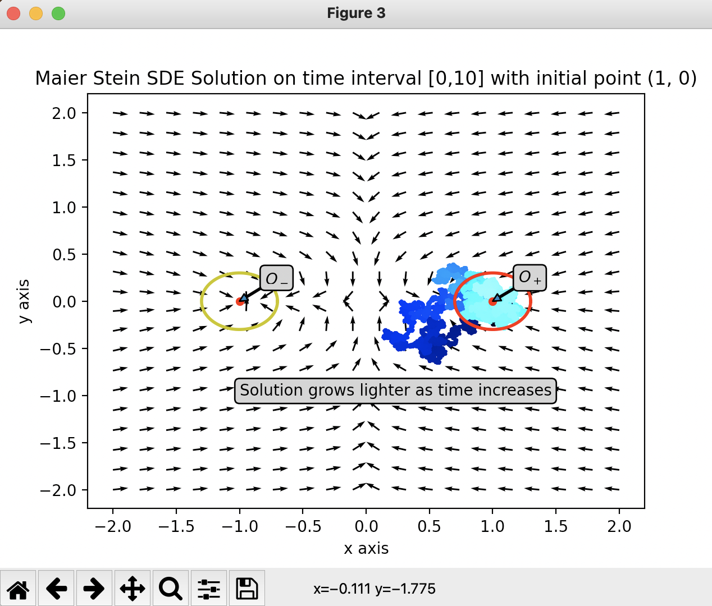

The equilibrium points are surrounded by two circles, 
which are sinks for trajectories: where they are bound to 
settle into, except for the random influence of Brownian motion.

We call these two encircled regions $A$ (on the left) and $B$ (on the right).
If a point is not inside $A$ or $B$, then it is in
$\Omega$, which is called the transition region.

We want to know about probabilities for how a particle travels
in this system.
One particularly important probability is the following one. 
This is the probability that a particle located
at $(x,y)$ will hit $B$ before it hits $A$.
This probability, denoted $q(x,y)$, 
is known as the **committor function**.
For example,

$$
q|_{\partial A} = 0
$$

because, how could it hit $B$ before hitting
$A,$ since it is hitting $A$ already! Conversely, 
$q|_{\partial B} = 1$.
 

The committor function satisfies the Kolmogorov backward equation:

$$
\begin{cases}
b \cdot \nabla q + \dfrac{\epsilon}{2}\Delta q = 0 & (x,y) \in \Omega \\
q|_{\partial A} = 0, \qquad q|_{\partial B} = 1
\end{cases}
$$

where $\Delta = \partial_{xx} + \partial_{yy}$ is the Laplacian.
We denote 
$b \cdot \nabla + \frac{\epsilon}{2} \Delta = \mathcal{L}$.

**How do we solve for the committor function?**

The approach in this repository is to initialize
a neural network, and then train it to be the committor function!
Our neural network will have two input nodes, one 
for each coordinate of the spatial region of the system. 
And it will have one output node for the probability of 
hitting $B$ before $A$, given the starting point (the input nodes).

So the neural network is just a function $NN: \mathbb R^2 \to \mathbb R$.
(Of course it will have a bunch of hidden layers.)
So we want to make sure that 

$$
NN(x,y) \approx q(x,y)
$$

for all $x,y \in \Omega$.

How do we do this? The idea is again simple. 
We just penalize the $NN$ whenever 
$\mathcal{L} (NN) (x,y) \ne 0$ (recall that neural networks
are (at least) twice weakly differentiable).
And we also penalize the neural network
if it doesn't satisfy $NN|_{\partial A} = 0$ and 
$NN|_{\partial B} = 1$.

This means that the loss function during neural network training
will be of the form

$$
\sum_{\text{training pts}}\left\lVert \mathcal{L} NN \right\rVert^2
+
\sum_{\partial A}(NN-0)^2
+
\sum_{\partial B}(1-NN)^2.
$$

This is called
a Physics-informed neural network 
because the "physics" of the system, e.g. the operator $\mathcal{L}$,
is encoded into the loss function during training.

## Sampling for Training Data

Although the neural network method doesn't require using training
points (e.g. a set of points in $\mathbb R^2$ where we measure the 
neural network) that are distributed according to the probability 
measure of the SDE, it is still a good idea to sample data points 
from this distribution. In other words, we just run 
long trajectories governed by the SDE, and take the points
this trajectory hits as training data.

The Euler Maruyama discretization is used for this. 
See Section 2.5 in `reports/REU-final-report-2022.pdf` for the details.
Enter the python interpreter by typing `python3` into the command prompt. 
Then enter the following code.

```
>>> from MaierSteinSolver.dataset import EulerMaruyama
>>> EM = EulerMaruyama(1e-4)
>>> my_path = EM.get_sample_path(1e5, [0,0])
```

This code block samples a trajectory, starting at the point $(0,0)$, 
using 100,000 timesteps of length $10^{-4}$.

```
>>> from MaierSteinSolver.plots import plot_trajectory
>>> plot_trajectory(my_path, 1e-4)
```

Then you will see
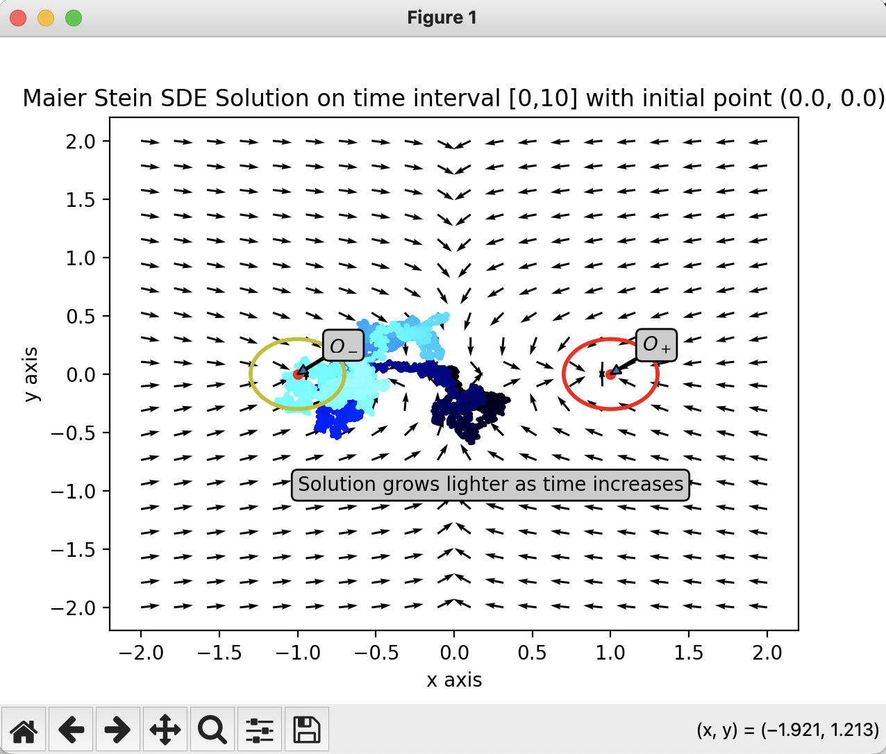

## Enhanced Sampling

Since trajectories spend too much time in the equilibrium 
regions, we modify the drift field. The resulting
behavior is that trajectories sample far more of the transition
region $\Omega$ compared to a typical trajectory.
This is called metadynamics, and is implemented in the 
class Metadynamics. See section 3.1 in `reports/A_neural_network_based_solver_for_quantifying_transition_processes_in_nongradient_SDEs.pdf` for the details on metadynamics. 

```
>>> from MaierSteinSolver.dataset import Metadynamics
>>> M = Metadynamics()
>>> G_L, sam_path = M.get_guassian_locations()
>>> from MaierSteinSolver.plots import plot_trajectory
>>> plot_trajectory(G_L, delta_t = 1e-4, with_direction_field = False, with_comments = False)
```
We've plotted the locations of the Gaussian deposits that
impact the drift field. Each dot provides a small gradient 
that the particle would have to work against to get closer
to that point. In other words, the Gaussian deposit increases the
potential energy at each dot.

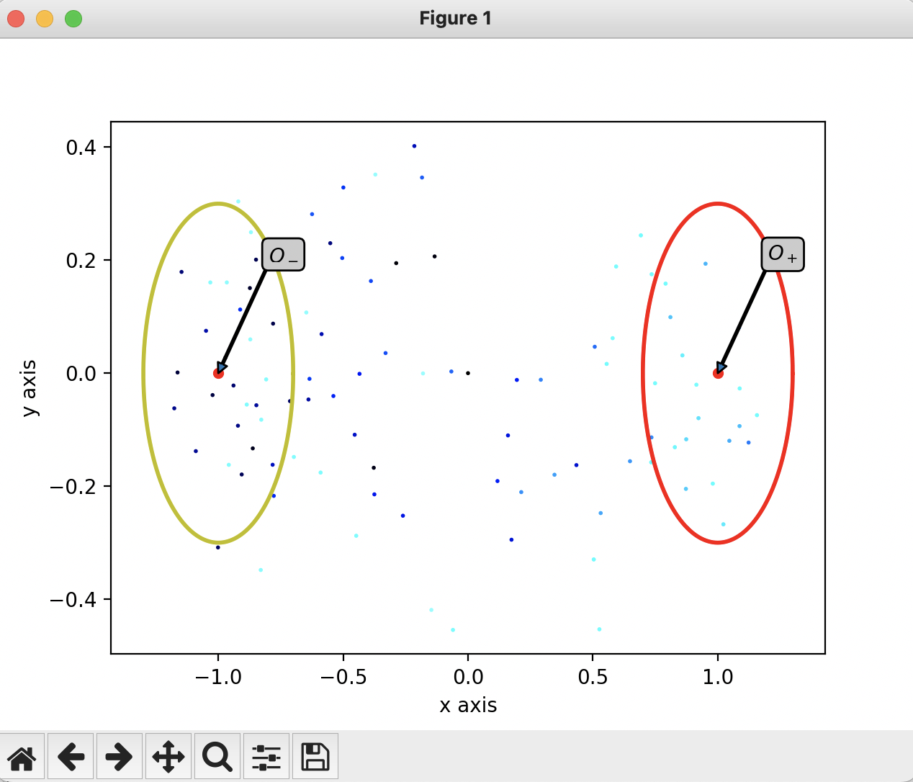

It is satisfying to see that a sample path,
sampled according to the metadynamics algo, despite
having the same number of iterations as Euler-Maruyama, 
managed to sample far more of the space:

```
>>> plot_trajectory(sam_path)
```

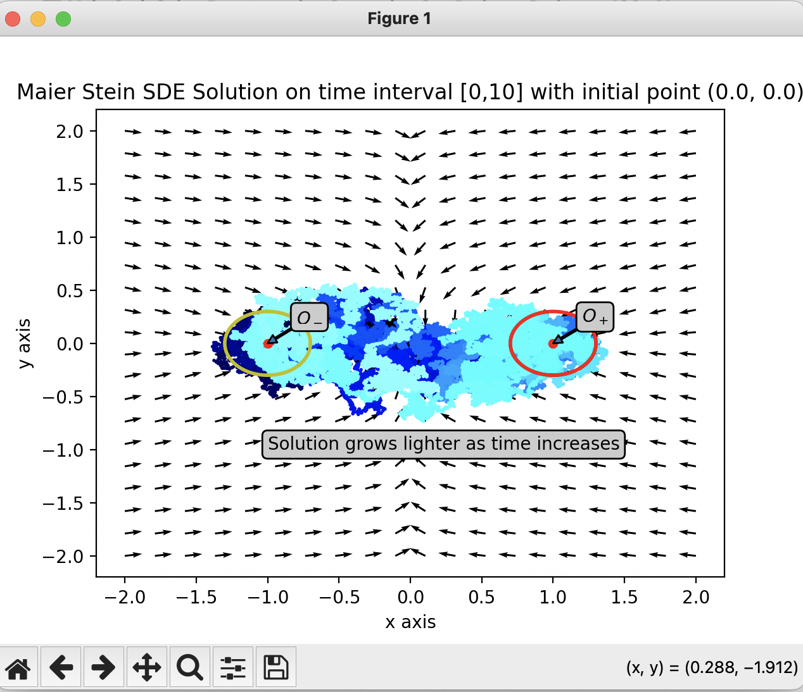

Technically `sam_path` above is a sample
that we collected when the Gaussian deposits
were still being identified. For the enhanced sample 
that we will eventually feed to the neural network, 
we work directly with the fully modified drift 
field (after all Gaussian deposits have been established).

Continuing with the `G_L` array from above,
we collect a sample of 500,000 points,
which takes about 4 minutes to run. This is a high enough
number of iterations to guarantee that the simulation
visits enough of the sample space. Also, 
the downside of the metadynamics algo is that
the Gaussian deposits cause the algo to lag,
which is why it takes 4 minutes. 

```
>>> path_biased = M.run_biased_sample_path(500000, G_L)
>>> plot_trajectory(path_biased, dot_size = 0.001)
```
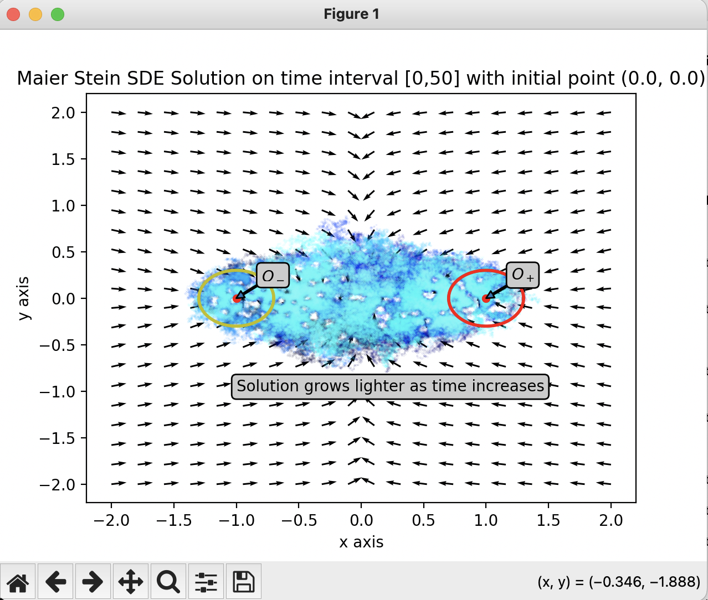

Since the committor function 
is undefined inside the equilibrium regions, we
remove the points falling inside regions
$A$ and $B$:

```
>>> from MaierSteinSolver.dataset import removeA_B
>>> path_no_A_B = removeA_B(path_biased)
>>> plot_trajectory(path_no_A_B, dot_size = 0.001)
```
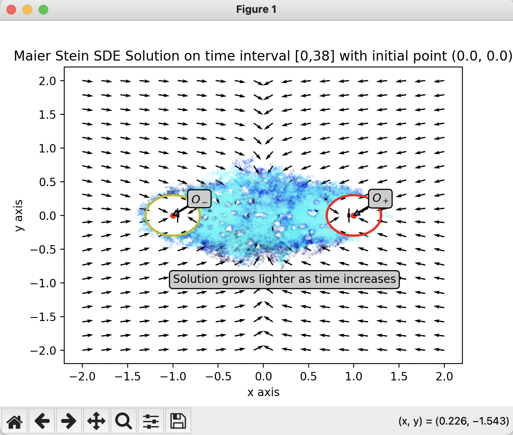

(Side note: the time interval ([0,38]) is a bug that
requires an easy future fix. T=38 is computed from 
the length of the array `path_no_A_B`
and the timestep length `delta_t = 1e-4`. The correct
interval is ([0,50]).)

Next, we delta-rarify, which means that
we make sure each point in the sample
has a $\delta$-neighborhood without any other
points. The idea is that we bumped up 
the number of points (500,000) to cover enough area,
but now we thin that dataset out to make 
neural network training much more efficient later on.

```
>>> from MaierSteinSolver.dataset import delta_rarify
>>> path_r = delta_rarify(path_no_A_B)
>>> plot_trajectory(path_r, dot_size = 0.001)
```

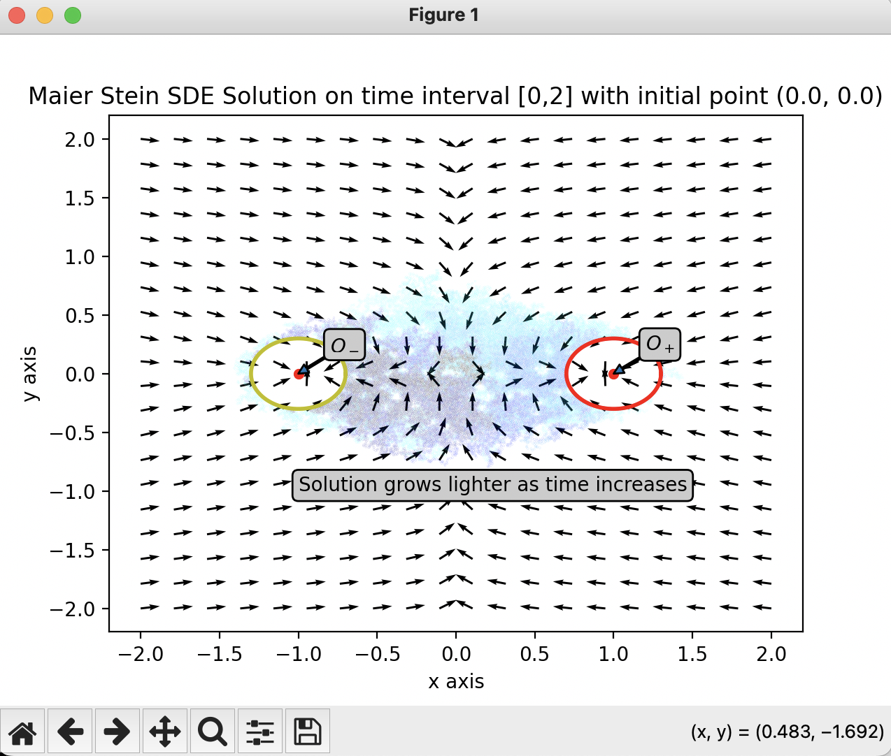

(Side note: see previous side note for the bug interval
[0,2].)

At this point `path_r` contains the points to 
be used for neural network training (excluding
the boundary points created when we ran `make data`).
Now we just save as a .csv
to the `PROCESSED_DATA_DIR`. In the future, we could use more 
elaborate naming conventions for the file
if we wanted to experiment with different timestep lengths, 
delta-sized neighborhoods, etc.

```
>>> from MaierSteinSolver.config import PROCESSED_DATA_DIR
>>> from MaierSteinSolver.dataset import points_to_csv
>>> num_pts = path_r.shape[0]
>>> points_to_csv(path_r, PROCESSED_DATA_DIR/f"enhanced_sample_{num_pts}pts.csv")
```
 
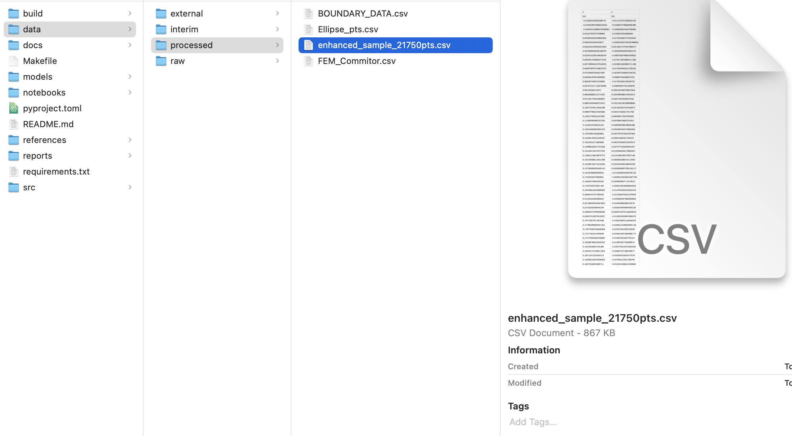


## Training

Now we use the command line (bash) instead of the python
interpreter.

First we set up a PROJ_ROOT variable so we don't 
have to do copy and pasting later on.
```
(.venv) ➜  MaierSteinSolverRepo git:(main) ✗ export PROJ_ROOT=$(python -c "from MaierSteinSolver.config import PROJ_ROOT; print(PROJ_ROOT)")
```
Next we navigate to the modeling folder. 
```
(.venv) ➜  MaierSteinSolverRepo git:(main) ✗ cd src/MaierSteinSolver/modeling
```

Next, we want to run `train.py` using the typer CLI. 
One illustration of typer is the following command line
output when we type `typer train.py run --help`. 
```
(.venv) ➜  modeling git:(main) ✗ typer train.py run --help
2026-11-19 11:17:20.717 | INFO     | MaierSteinSolver.config:<module>:11 - PROJ_ROOT path is: /Users/commented-out
                                                                                                                              
 Usage: typer [PATH_OR_MODULE] run [OPTIONS]                                                                                  
                                                                                                                              
 Parameters:  - hidden_layers: str. Example: "20,25,30" means the first hidden     layer has 20 nodes, the second has 25, and 
 the third has 30.      Make sure that there are commas. If using typer, use, e.g.      `typer train.py run --hidden-layers   
 20,25,20`                                                                                                                    
                                                                                                                              
 - learning_rate: str. Example: "1.0." The solver sometimes didn't                                                            
     converge with 10.0 learning rate.                                                                                        
                                                                                                                              
 - transition_region_path: str of a filepath. This should be a .csv file                                                      
     containing the data points in the transition region.                                                                     
                                                                                                                              
╭─ Options ──────────────────────────────────────────────────────────────────────────────────────────────────────────────────╮
│ --hidden-layers                 TEXT  [default: 20,20]                                                                     │
│ --learning-rate                 TEXT  [default: 1.0]                                                                       │
│ --transition-region-path        PATH  [default:                                                                            │
│                                       /Users/commented-out │
│ --boundary-data-path            PATH  [default:                                                                            │
│                                       /Users/commented-out │
│ --model-path                    PATH  [default:                                                                            │
│                                       /Users/commented-out │
│ --help                                Show this message and exit.                                                          │
╰────────────────────────────────────────────────────────────────────────────────────────────────────────────────────────────╯
```

Now let's train a model with 3 hidden layers, each having
30 nodes. Let's train this model on the training data we produced
from the previous metadynamics routine, namely, `enhanced_sample_21750pts.csv`.
We save the model to the file
`model-30-30-30.pt`. **Make sure to swap in your version of enhanced_sample_21750pts.csv
as the number of points will be different each time.**
Also, feel free to try out different NN archictectures, by replacing `30,30,30` by, e.g.,
`20,25` or whatever. 

```
(.venv) ➜  modeling git:(main) ✗ typer train.py run --hidden-layers 30,30,30 --transition-region-path "$PROJ_ROOT/data/processed/enhanced_sample_21750pts.csv" --model-path "$PROJ_ROOT/models/model-30-30-30.pt"
```

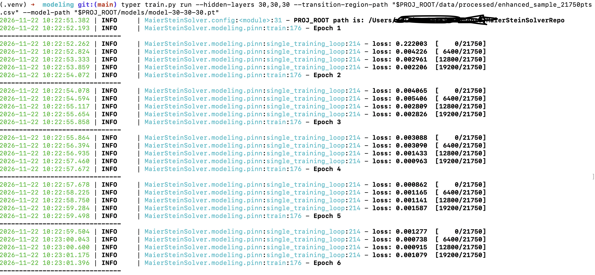


## Testing

We continue with the terminal 
session from the above section on training.
The next step is to see how the model, 
saved at `PROJ_ROOT/models/model-30-30-30.pt`, 
evaluates the canonical test data, saved
at `PROJ_ROOT/data/processed/Ellipse_pts.csv`.
We will save the model's predictions 
at `PROJ_ROOT/data/processed/predictions-30-30-30.csv`.

```
(.venv) ➜  modeling git:(main) ✗ typer predict.py run --hidden-layers 30,30,30 --features-path "$PROJ_ROOT/data/processed/Ellipse_pts.csv" --model-path "$PROJ_ROOT/models/model-30-30-30.pt" --predictions-path "$PROJ_ROOT/data/processed/predictions-30-30-30.csv"
```
The command line output is...
```
2026-11-19 13:47:11.576 | INFO     | MaierSteinSolver.config:<module>:11 - PROJ_ROOT path is: /Users/commented-out
2026-11-19 13:47:11.592 | INFO     | predict.py:main:29 - Performing inference for model based on NN with [30, 30, 30] hidden layer structure.
2026-11-19 13:47:11.667 | SUCCESS  | predict.py:main:47 - Inference complete.
```

Next, we enter the python interpreter
and plot the (30,30,30) layer model's committor function
against the committor function produced by the finite
element's method.

```
>>> from MaierSteinSolver.plots import plot_q_side_by_side
>>> from MaierSteinSolver.config import PROCESSED_DATA_DIR
>>> plot_q_side_by_side(PROCESSED_DATA_DIR/"predictions-30-30-30.csv")
```

We get:

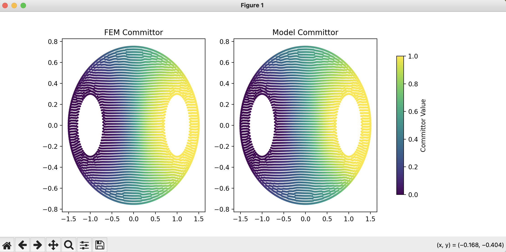

Next we plot the absolute difference between
the ground truth FEM committor and the [30,30,30] layer
model committor. 

```
>>> from MaierSteinSolver.config import PROCESSED_DATA_DIR
>>> from MaierSteinSolver.plots import compare_fem_absolute
>>> compare_fem_absolute(PROCESSED_DATA_DIR/"predictions-30-30-30.csv")
```
We get:

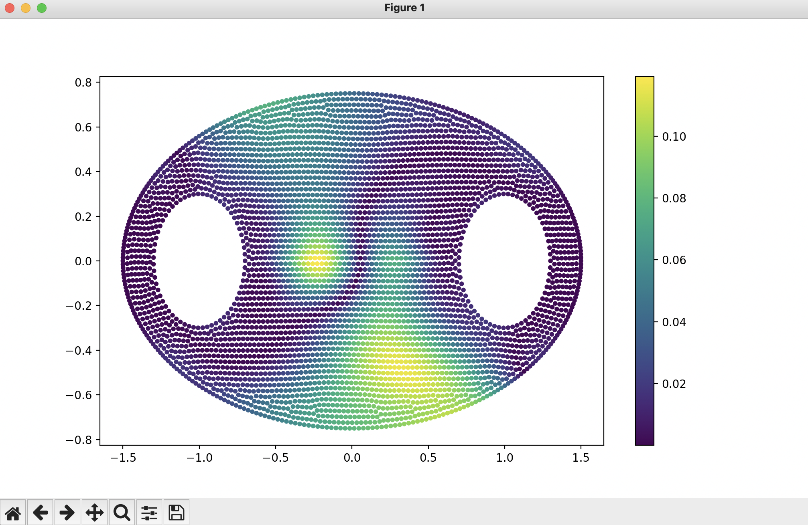


## Project Organization

Below is the initial project organization
for a typical cookiecutter data science machine learning repo.
I didn't end up posting much to the docs folder, 
but I'm leaving it in case I need it later.
Also, I didn't use the exact data folder structure, since this solver's
data pipeline is not fit for the usual supervised learning data pipeline.

```
├── LICENSE            <- Open-source license if one is chosen
├── Makefile           <- Makefile with convenience commands like `make data` or `make train`
├── README.md          <- The top-level README for developers using this project.
├── data
│   ├── external       <- Data from third party sources.
│   ├── interim        <- Intermediate data that has been transformed.
│   ├── processed      <- The final, canonical data sets for modeling.
│   └── raw            <- The original, immutable data dump.
│
├── docs               <- A quarto webpage
│
├── models             <- Trained and serialized models, model predictions, or model summaries
│
├── notebooks          <- Jupyter notebooks. 
│
├── pyproject.toml     <- Project configuration file with package metadata for 
│                         Maier-Stein-Solver and configuration for tools like black
│
├── references         <- Data dictionaries, manuals, and all other explanatory materials.
│
├── reports            <- Generated analysis as HTML, PDF, LaTeX, etc.
│   └── figures        <- Generated graphics and figures to be used in reporting
│
├── requirements.txt   <- The requirements file for reproducing the analysis environment, e.g.
│                         generated with `pip freeze > requirements.txt`
│
├── setup.cfg          <- Configuration file for flake8
│
├── src
    └── Maier-Stein-Solver   <- Source code for use in this project.
        │
        ├── __init__.py             <- Makes Maier-Stein-Solver a Python module
        │
        ├── config.py               <- Store useful variables and configuration
        │
        ├── dataset.py              <- Scripts to download or generate data
        │
        ├── features.py             <- Code to create features for modeling
        │
        ├── modeling             
        │   ├── __init__.py 
        │   ├── pinn.py             <- Code to store loss function logic and neural network architecture
        │   ├── predict.py          <- Code to run model inference with trained models          
        │   └── train.py            <- Code to train models
        │
        └── plots.py                <- Code to create visualizations
```

--------

